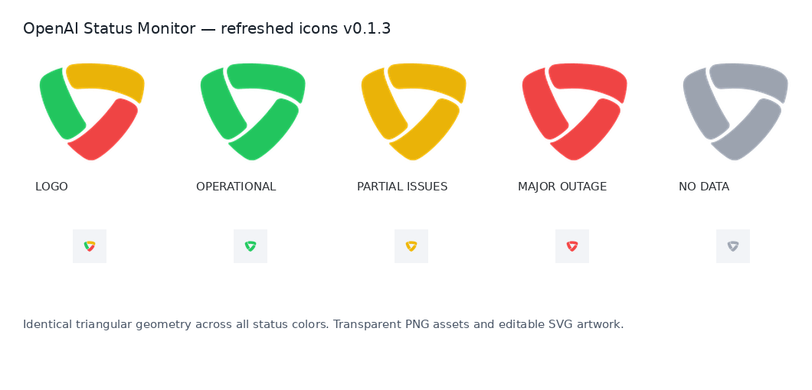

# OpenAI Status Monitor — Chrome Extension

Repository: `openai-status-chrome-monitor`.

**A minimal, unofficial Chrome extension for checking the public status of OpenAI services.**



This independent project reads the [OpenAI Status](https://status.openai.com/) public endpoints and displays the overall service status in the browser toolbar. Click the icon to see the status of services you have selected.

> **Unofficial project:** Not affiliated with, endorsed by, or sponsored by OpenAI. "OpenAI" and "ChatGPT" are trademarks of their respective owner. Status information is reported by OpenAI, not independently measured by this extension.

## Features

- **One icon, four states:** green (operational), yellow (partial disruption or maintenance), red (major or critical issue), gray (data unavailable).
- **Customizable popup:** choose the components you want to track from the list published on OpenAI Status.
- **Automatic polling:** every 5, 30, or 60 minutes; manual-only mode is also available.
- **One-click refresh** and last-successful-check timestamp.
- **No sign-in, API key, analytics, notifications, or external backend.**
- Works with **Chrome Manifest V3**, using the browser's local storage and alarms.

The toolbar icon shows the **overall status** reported by OpenAI. The selected component list controls the popup only; individual user experiences may differ from OpenAI's aggregate status.

## Download and install

**Chrome Web Store publication is planned, but the extension is not listed there yet.**

Download a ready-to-install ZIP archive from this repository:

| Version | Status | Language |
| --- | --- | --- |
| [v0.1.3 — stable](downloads/openai-status-chrome-monitor-v0.1.3.zip) | Matches the current source code on `main` | Russian |
| [v0.1.4 — preview](downloads/openai-status-chrome-monitor-v0.1.4-preview.zip) | Translation preview; source review and merge pending | English, Russian, Czech |

**Quick installation:** download the ZIP, extract it, open `chrome://extensions`, enable **Developer mode**, click **Load unpacked**, and select the extracted folder containing `manifest.json`.

See **[INSTALL.md](INSTALL.md)** for screenshots-independent step-by-step instructions, updating an existing unpacked extension, and troubleshooting. GitHub ZIP installations do **not** update automatically.

## Privacy and permissions

The extension requests only:

| Permission | Purpose |
| --- | --- |
| `storage` | Save selected service IDs, refresh interval, and the latest status snapshot locally. |
| `alarms` | Schedule checks at the chosen interval. |
| `https://status.openai.com/*` | Retrieve public service and component status. |

It makes HTTPS requests to these endpoints:

- `https://status.openai.com/api/v2/status.json`
- `https://status.openai.com/api/v2/components.json`

The extension itself does not collect or transmit personal data or usage analytics. See [Privacy](PRIVACY.md) for details. As with any HTTPS request, the remote status service may receive technical request metadata such as your IP address.

## Technology and project structure

Plain JavaScript, HTML, CSS, and SVG/PNG assets; **no build tooling or external runtime dependencies**.

```text
manifest.json         Chrome extension configuration
background.js         Service worker, status polling, toolbar icon
shared.js             Status-to-color mapping, grouping, defaults
popup.html / popup.js Toolbar popup
options.html / options.js  Component selection and refresh settings
styles.css            Common styling
icons/                Original three-segment logo and four status variants
assets/               Repository documentation images
```

## Limitations

- Automatic checks are approximate: Chrome does not wake a sleeping computer to run an alarm.
- The component catalog and its display grouping depend on the public status API, which OpenAI can change.
- The current `main` source (v0.1.3) uses Russian UI. A separate **v0.1.4 preview ZIP** includes English, Russian, and Czech, with browser-language detection and a manual selector; its updated source code has not yet been merged into `main`.

## Contributing and license

This is an early personal project. Feedback via GitHub Issues is welcome. **No open-source license has been selected yet**; publication of the source code alone does not grant reuse or redistribution rights. A license can be added after the owner chooses one.

## Releases

The source on `main` is **v0.1.3**. The separately downloadable **v0.1.4 preview** is provided for early testing; its source integration is still pending. See [Changelog](CHANGELOG.md).

## Planned Chrome Web Store release

Publication in the **Chrome Web Store is planned; no launch date has been announced**. The extension can currently be installed from the GitHub ZIP files using Chrome Developer mode. Preparation includes real-Chrome testing, localization review, store listing material, privacy and permission review, and Google's publication process.

See [ROADMAP.md](ROADMAP.md) for the preparation checklist. This is an independent project, **not an official OpenAI extension**.
